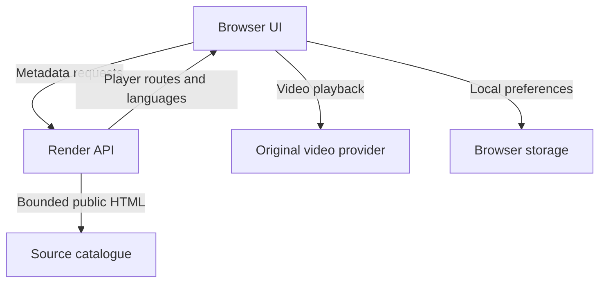

# Architecture

The frontend is plain HTML, CSS and browser ES modules. The API is FastAPI with HTTPX and BeautifulSoup. Metadata is cached in process for five minutes; it is disposable after restart. No database or video storage is required.

## Frontend modules

| File | Responsibility |
| --- | --- |
| `app.js` | Browse/detail/watch transitions and UI binding |
| `api.js` | Config validation, timeouts, abortable JSON requests |
| `storage.js` | Versioned local preferences, favourites and recent titles |
| `player.js` | Native direct video or cross-origin provider iframe |
| `icons.js` | Small inline SVG icon system |
| `styles.css` | Layout, themes, planet artwork, responsive breakpoints |
| `player.css` | Watch layout and player-source panel |

Favourites are capped at 200, recent titles at 50. No analytics are added by Velora. Provider players are third-party pages with their own behavior. Changing the catalogue tab does not recreate the watch region, so its iframe is preserved. Closing the player deliberately releases it. Reloading the whole website does not restore provider progress.

## Backend modules

- `parsers.py`: pure public-HTML parsers. Scripts are read only when they contain the explicitly expected JSON CONFIG literal.
- `network.py`: bounded HTTPS GET, redirects restricted at each hop, MIME/body limits, DNS public-address check, four concurrent source fetches. HEAD-only direct-media checks.
- `main.py`: validated identifiers, catalogue/title/resolve/season endpoints, TTL cache, explicit CORS and a bounded request rate limiter.
- `seasons.py`: optional browser operation using the public season dropdown and the resulting episode DOM; one at a time. Ads, fonts, images and media requests are blocked because they are unnecessary for metadata.

## Data ownership and playback

The API returns discovered provider routes, not invented movie links. A language entry selects a different provider source; it is not guaranteed to be an in-file audio track. A provider iframe cannot be controlled across origins. Native controls/shortcuts apply only to direct mode.

The direct adapter looks only at source `<video>` elements for the narrowly approved media hosts. It rejects chunk fragments, follows no HEAD redirects and checks MIME without transferring a video body. HEAD success does not verify codec, CORS, range-seeking, expiry or full playback. Downloads are direct host links; attachment naming and whether a browser saves or plays them depend on that host.

No transcoding, ad-shortener bypass, arbitrary URL resolver or public proxy is included. No claim of adaptive bitrate or universal codec support is made.

## Operational constraints

Use one API worker for this small in-process cache/rate limiter. More workers have independent state. For larger deployment, use shared rate limits and a metadata cache, not video storage. DNS is checked before fetching but the HTTP transport resolves separately; this is not a fully pinned DNS-rebinding defense. Destinations are fixed reviewed domains rather than client URLs. Add egress controls if expanding provider destinations.
